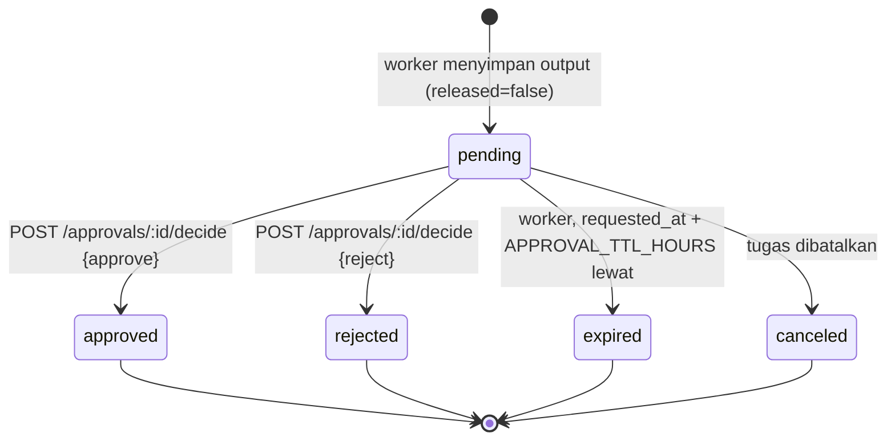

# Alur Persetujuan Manusia (Human-in-the-Loop)

Persetujuan Phase 5 bersifat **persisten di database** dan **ditegakkan backend**: hasil run yang memerlukan
persetujuan tidak dirilis ke pengguna sebelum ada keputusan, dan keputusan dicatat beserta siapa yang memutus.
Kode: `api/modules/approvals/{service,repository,routes}.ts`, pembuatan permintaan di `api/modules/runs/worker.ts`,
tabel `agent_approvals` di `db/migrations/0008_agent_tasks.sql`.

**Status:** VERIFIED COMPLETE (test `tests/integration/worker.test.ts` dan `tests/integration/tasks.test.ts`
untuk tertunda → 409 output, setujui, tolak, keputusan ganda, kebijakan swa-persetujuan, kedaluwarsa, pembatalan; QA
browser di `docs/screenshots/office-live-approval-1920x1080-*.jpg`).

## 1. Ruang lingkup: satu aksi terlindungi

Saat ini satu tipe aksi: `release_result`. Tugas dengan `requiresApproval: true` dieksekusi worker seperti biasa,
tetapi keluaran disimpan dengan `released = false`, run dan tugas menjadi `waiting_approval`, dan satu baris
`agent_approvals` (`status = pending`) dibuat dalam transaksi yang sama. **Persetujuan menggerbangi perilisan hasil
yang sudah dihasilkan; tidak ada eksekusi lanjutan setelah persetujuan.** Aksi lain (mis. mengirim email, memanggil
tool eksternal) belum ada dan karenanya tidak ada yang dieksekusi "setelah disetujui".

Unik per `(run_id, action_type)`, sehingga satu run tidak pernah punya dua permintaan untuk aksi yang sama.

## 2. Siklus hidup

| Keputusan / peristiwa | Efek pada output    | Run / tugas                                  | Event realtime                                               |
| --------------------- | ------------------- | -------------------------------------------- | ------------------------------------------------------------ |
| `approve`             | `released = true`   | `completed`                                  | `approval.decided`, `agent.run.completed` (`released: true`) |
| `reject`              | tetap tidak dirilis | `failed` `APPROVAL_REJECTED` (tidak diulang) | `approval.decided`, `agent.run.failed`                       |
| kedaluwarsa (TTL)     | tetap tidak dirilis | `failed` `APPROVAL_EXPIRED`                  | `agent.run.failed`                                           |
| tugas dibatalkan      | tetap tidak dirilis | `canceled`                                   | `agent.run.canceled`                                         |

Keputusan bersifat final: permintaan yang sudah `approved`/`rejected` menolak keputusan berikutnya (409).

## 3. Endpoint

| Method & path                       | Izin               | Catatan                                                                 |
| ----------------------------------- | ------------------ | ----------------------------------------------------------------------- |
| `GET /api/v1/approvals?status=`     | `approvals.read`   | Semua status secara default; filter `status=pending`                    |
| `GET /api/v1/approvals/:id`         | `approvals.read`   | 404 bila bukan milik tenant aktif                                       |
| `POST /api/v1/approvals/:id/decide` | `approvals.decide` | Body `{ decision: 'approve' \| 'reject', note? }` (note ≤ 500 karakter) |
| `GET /api/v1/runs/:id/output`       | `tasks.read`       | 409 `OUTPUT_PENDING_APPROVAL` selama belum dirilis                      |

Kode error keputusan:

| HTTP | `code`                     | Kapan                                                      |
| ---- | -------------------------- | ---------------------------------------------------------- |
| 403  | `APPROVAL_SELF_DECISION`   | `APPROVAL_FORBID_SELF=true` dan pemutus = pembuat tugas    |
| 409  | `APPROVAL_ALREADY_DECIDED` | Sudah `approved`/`rejected`                                |
| 409  | `APPROVAL_EXPIRED`         | `expires_at` lewat (meski sweeper belum menandai)          |
| 409  | `APPROVAL_NOT_ACTIONABLE`  | Status `expired`/`canceled`, atau run/tugas sudah terminal |
| 404  | `APPROVAL_NOT_FOUND`       | Id tidak ada di tenant aktif (RLS)                         |

## 4. Kebijakan

| Variabel               | Default | Arti                                                                                                       |
| ---------------------- | ------- | ---------------------------------------------------------------------------------------------------------- |
| `APPROVAL_TTL_HOURS`   | `24`    | Permintaan tertunda kedaluwarsa setelah TTL; worker menandainya `expired` dan run gagal `APPROVAL_EXPIRED` |
| `APPROVAL_FORBID_SELF` | `false` | `true` = pembuat tugas tidak boleh memutus permintaannya sendiri (pemisahan tugas)                         |

Izin per peran (migrasi 0008; dapat diubah di tabel `role_permissions`, bukan di kode):

| Peran  | `approvals.read` | `approvals.decide` |
| ------ | :--------------: | :----------------: |
| owner  |        ✓         |         ✓          |
| admin  |        ✓         |         ✓          |
| member |        ✓         |         —          |
| viewer |        ✓         |         —          |

## 5. Penegakan di database

- `agent_approvals` ber-RLS (`ENABLE` + `FORCE`): SELECT dibatasi `tenant_id = app.current_tenant_id()` (atau pemilik
  skema untuk fungsi definer); INSERT hanya konteks worker (`app.is_worker()`); UPDATE hanya worker atau pengguna
  dengan `app.has_permission('approvals.decide')`. Tanpa izin di database, `UPDATE` dari API mana pun mengenai 0 baris.
- Keputusan ditulis dengan CAS `pending → approved|rejected` (`approvalsRepository.decide`); perlombaan dua pemutus
  menghasilkan satu pemenang, yang lain 409.
- Perilisan output (`agent_run_outputs.released`) dan transisi run/tugas terjadi dalam **satu transaksi** dengan
  keputusan dan baris outbox event.
- `decided_by_user_id`, `decided_at`, `decision_note` dicatat; `requested_by` = `worker`.

## 6. Pengalaman di game dan halaman tugas

- Panel perintah menampilkan blok **Persetujuan dibutuhkan** dengan ringkasan aksi; tombol Setujui/Tolak hanya untuk
  pengguna ber-`approvals.decide`, selain itu teks "Butuh izin approvals.decide".
- Robot berada di state `waiting_approval` (ikon/pose menunggu) sampai keputusan; setelah disetujui → `completed` →
  idle dan tombol **Lihat hasil** muncul.
- `/tasks/:id` menampilkan status, run, dan keluaran hanya bila sudah dirilis.

## 7. Batasan yang disadari

- Hanya satu pemutus diperlukan (tidak ada kuorum/multi-level).
- Tidak ada notifikasi e-mail/push ke pemutus; permintaan terlihat di game, `/tasks`, dan `GET /approvals`.
- Jendela sweeper kedaluwarsa = interval tick worker; API tetap menolak keputusan atas permintaan yang sudah lewat
  TTL meskipun sweeper belum berjalan.
