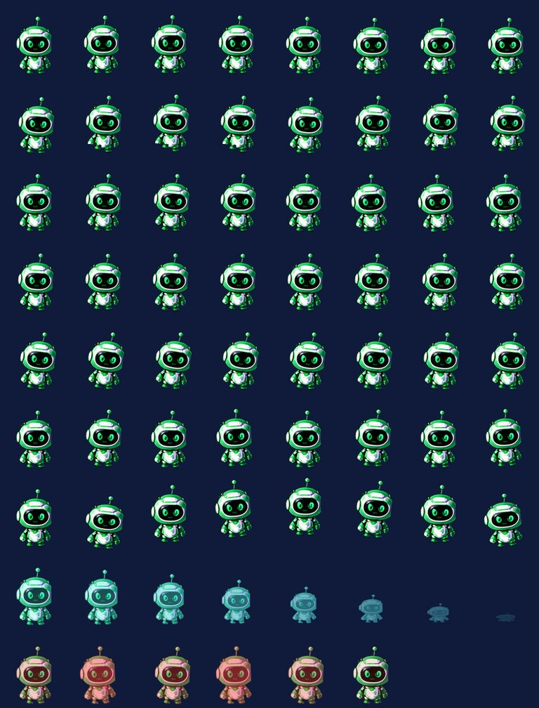

# Sistem Animasi Karakter

Status animasi frame artist: **BELUM LENGKAP (INCOMPLETE)**. Sistem animasinya sendiri berfungsi penuh: kontrak sheet,
atlas, state machine, renderer, dan pengujian. Namun **frame-nya diturunkan secara prosedural** dari satu sprite statis
per karakter (kualitas prototipe), bukan digambar artist. Rekonstruksi v3 saat ini mencakup latar dan pulau statis;
frame karakter belum diganti (lihat `docs/game-asset-quality-report.md`).

Robot tidak sekadar bergeser sebagai PNG statis. Setiap state memutar baris frame yang berbeda: langkah kaki bergantian
saat berjalan, larut-cahaya saat teleport, guncangan merah saat error, lompatan saat selesai. Variasi pada baris idle,
think, work, read, dan communicate hanya berupa transformasi (ayun, miring, squash) dari pose yang sama, sehingga
tampak mirip satu sama lain. Mengganti sheet dengan frame artist **tidak memerlukan perubahan kode** karena kontraknya
tetap.



## 1. Kontrak animasi (sama untuk kelima karakter)

Sumber kebenaran: `app/game/animation-spec.ts`. File per karakter ada di `public/game-assets-v2/agents/{karakter}/`:
`sheet.webp` + `atlas.json`. `bun run check:assets` memverifikasi dimensi sheet, anchor, jumlah frame, fps, dan baris
setiap animasi terhadap kontrak ini.

| Properti      | Nilai                                                                        |
| ------------- | ---------------------------------------------------------------------------- |
| Ukuran frame  | 192 × 224 px                                                                 |
| Anchor (kaki) | (96, 214) — titik yang diletakkan di koordinat dunia robot                   |
| Tinggi badan  | 176 px di sheet → 101 unit dunia di layar                                    |
| Sheet         | 8 kolom × 9 baris = 1536 × 2016 px, WebP alpha                               |
| Arah          | sheet menghadap kanan; kiri = cermin horizontal (`scaleX(-1)`) oleh renderer |

| Baris | Animasi       | Frame | fps | Loop  | Arah  | Transisi                                | Dipakai oleh state                 |
| ----: | ------------- | ----: | --: | ----- | ----- | --------------------------------------- | ---------------------------------- |
|     0 | `idle`        |     8 |   6 | ya    | depan | —                                       | `idle`, `offline` (grayscale)      |
|     1 | `walk`        |     8 |  12 | ya    | kanan | cermin untuk kiri                       | `moving` (leg jalan)               |
|     2 | `think`       |     8 |   5 | ya    | depan | —                                       | `thinking`, `waiting_approval`     |
|     3 | `work`        |     8 |  10 | ya    | depan | —                                       | `working`, `using_tool`            |
|     4 | `read`        |     8 |   6 | ya    | depan | —                                       | `researching`, `reading`           |
|     5 | `communicate` |     8 |   8 | ya    | depan | —                                       | `communicating`                    |
|     6 | `celebrate`   |     8 |  12 | tidak | depan | tahan frame akhir → `idle`              | `completed`                        |
|     7 | `teleport`    |     8 |  16 | tidak | depan | maju saat masuk, **mundur** saat keluar | leg teleport (masuk/keluar portal) |
|     8 | `error`       |     6 |  12 | tidak | depan | tahan frame akhir → `idle`              | `failed`                           |

### Format `atlas.json`

```json
{
  "version": 2,
  "character": "sage",
  "name": "Sage",
  "archetype": "Peneliti",
  "image": "sheet.webp",
  "quality": "procedural-prototype",
  "qualityNote": "Frame diturunkan secara prosedural dari satu sprite statis …",
  "sheet": { "width": 1536, "height": 2016, "columns": 8, "rows": 9 },
  "frame": { "width": 192, "height": 224 },
  "anchor": { "x": 96, "y": 214 },
  "animations": {
    "walk": {
      "frames": [{ "x": 0, "y": 224, "w": 192, "h": 224 }, "… 8 frame"],
      "fps": 12,
      "loop": true,
      "direction": "right",
      "mirrorForLeft": true,
      "row": 1,
      "frameCount": 8
    }
  }
}
```

`quality: "procedural-prototype"` menandai sheet saat ini. Sheet artist harus memakai `"artist"` (atau label lain yang
jujur) dengan kontrak yang sama.

## 2. Cara frame prototipe dibuat (fallback sementara)

`bun run assets:v2` (`scripts/build-game-assets-v2.ts`) membangun sheet dari `characters/{karakter}.png` yang sudah
diperbaiki (sisi kanan yang terpotong tipis diperbaiki simetris, halo dikurangi):

- Setiap frame = sprite sumber yang ditransformasi menurut `frameRecipe(animasi, frame)`: geser, rotasi berporos di
  kaki, squash/stretch, alpha, dan tint.
- `walk`: wilayah kaki (±30% lebar dari poros, 14% bawah badan) diangkat bergantian kiri/kanan, sementara badan
  digambar dengan lubang di wilayah itu agar tidak ada garis sambungan.
- `teleport`: badan menyempit dan menghilang dengan tint cyan; `error`: guncangan horizontal dengan tint merah;
  `celebrate`: lompatan dengan squash saat mendarat.
- Resampling bilinear premultiplied, keluaran WebP (RGB kualitas 90, alpha lossless; ±450–520 KB per sheet).

Batasan yang jujur: tidak ada pose tangan/kepala baru, tidak ada arah hadap belakang/isometrik, tidak ada detail
gerak sekunder. Inilah sebabnya status animasi artist **INCOMPLETE**. Spesifikasi frame artist ada di
`docs/game-asset-quality-report.md` §5 (prioritas 1).

### Mengganti dengan frame artist

1. Gambar 9 animasi per karakter dengan ukuran frame, anchor, dan urutan baris di atas (boleh @2×; perbarui
   `AGENT_FRAME` jika resolusi frame berubah).
2. Simpan sebagai `public/game-assets-v2/agents/{karakter}/sheet.webp` dan tulis `atlas.json` dengan `quality` yang
   sesuai.
3. Jalankan `bun run check:assets`. Renderer, mesin, dan state machine tidak perlu diubah.

## 3. State aktivitas → presentasi

Sumber: `app/game/agent-state.ts`. Setiap state menentukan animasi, label status, efek visual, dan apakah lampu
workstation menyala. Panel perintah dan log aktivitas membaca label yang sama.

| State              | Animasi       | Label                | Efek                      | Lampu workstation |
| ------------------ | ------------- | -------------------- | ------------------------- | ----------------- |
| `offline`          | `idle`        | Offline              | — (sprite grayscale)      | —                 |
| `idle`             | `idle`        | Siaga                | —                         | —                 |
| `moving`           | `walk`        | Berpindah            | —                         | —                 |
| `thinking`         | `think`       | Berpikir             | partikel                  | ya                |
| `working`          | `work`        | Bekerja              | hologram                  | ya                |
| `researching`      | `read`        | Meriset              | partikel                  | ya                |
| `reading`          | `read`        | Membaca              | —                         | ya                |
| `using_tool`       | `work`        | Memakai alat         | hologram                  | ya                |
| `communicating`    | `communicate` | Berkomunikasi        | —                         | —                 |
| `waiting_approval` | `think`       | Menunggu persetujuan | ikon jam pasir (approval) | ya                |
| `completed`        | `celebrate`   | Selesai              | ikon centang (success)    | —                 |
| `failed`           | `error`       | Gagal                | ikon peringatan (alert)   | —                 |

Transisi sah (`TRANSITIONS`), dengan `moving` dapat disela kapan saja:

```text
offline          → idle
idle             → moving, communicating, waiting_approval, completed, offline, failed, thinking/working/researching/reading/using_tool
moving           → idle, communicating, failed, (state kerja)
thinking         → moving, idle, communicating, waiting_approval, failed, completed, (state kerja)
working          → moving, idle, communicating, waiting_approval, completed, failed, (state kerja)
researching      → moving, idle, communicating, completed, failed, (state kerja)
reading          → moving, idle, communicating, completed, failed, (state kerja)
using_tool       → moving, idle, communicating, waiting_approval, completed, failed, (state kerja)
communicating    → moving, idle, waiting_approval, completed, (state kerja)
waiting_approval → working, idle, failed, communicating
completed        → idle, moving, communicating
failed           → idle, moving
```

Contoh dari brief yang diuji: `idle → moving → researching → working → completed → idle`,
`working → waiting_approval → working → completed`, `working → failed → idle`. `idle → completed` diizinkan untuk
perayaan akhir misi dan karena resync live dapat mengungkap run yang sudah selesai. `completed` yang dicapai otomatis
(lewat `next`) kembali ke `idle` setelah 2 detik.

`moving` adalah state visual sementara. Mode live tidak pernah menurunkan status bisnis dari timer frontend (lihat
`docs/live-agent-event-mapping.md`).

## 4. Arsitektur render

```text
Nuxt 4 (layout game) → GameOffice.vue (HUD, panel, shadcn-vue)
  → useOfficeEngine()          jembatan Vue ↔ mesin; satu loop requestAnimationFrame
      → OfficeEngine            app/game/engine.ts — posisi, rute, aktivitas, frame (TS murni)
      → SimulationController    app/game/simulation.ts — skenario pratinjau
      → createDomRenderer()     app/game/dom-renderer.ts — menulis gaya DOM langsung
  → GameWorld.vue → OfficeActor.vue / OfficeTeleportOrb.vue (elemen yang ditulis renderer)
```

- **Satu loop** `requestAnimationFrame` untuk seluruh dunia (`useOfficeEngine`), tidak per komponen. Urutannya:
  `engine.tick(dt)`, lalu `simulation.update()`, lalu `renderer.render(engine.renderStates())`.
- **Tanpa reaktivitas Vue per frame.** Renderer menulis langsung `--ax/--ay` (posisi kaki, unit dunia),
  `background-position` (frame), `scaleX` (arah), `visibility`, dan `z-index` (kedalaman = 100 + y), hanya bila nilainya
  berubah. `snapshot` Vue (`shallowRef`) diperbarui hanya pada event diskret (aktivitas, tiba, rute, teleport, ucapan,
  simulasi), dipakai untuk label, gelembung ucapan, efek, panel, dan roster.
- **SSR aman.** Dunia dan posisi awal dibuat identik di server dan browser (tanpa trigonometri/`Math.hypot` di jalur
  render), sehingga robot ikut di-SSR tanpa hydration mismatch. `OfficeActor` hanya memakai posisi Vue untuk render
  pertama (non-reaktif), lalu renderer menjadi pemiliknya.
- **Hit testing** memakai tombol DOM asli per robot (fokus keyboard, tooltip, `aria-label`).
- **Reduced motion.** Dengan `prefers-reduced-motion` (dibaca live via `matchMedia`) robot tiba seketika tanpa animasi
  jalan/teleport, loop animasi berhenti di frame 0, dan pulsa CSS dimatikan (`motion-safe:`).
- **Pemantauan performa:** FPS dan frame terburuk per detik ditulis ke `data-fps` / `data-worst-frame-ms` pada elemen
  panggung (bukan state Vue). Dipakai oleh pengukuran di bawah.

## 5. Evaluasi PixiJS v8 vs DOM — keputusan: **pertahankan DOM**

Diukur di Chrome (headless, Apple M2) dengan sheet nyata kelima karakter. Bundel Pixi = aplikasi minimal setara
kebutuhan (Application, Assets, 5 × AnimatedSprite dari sheet 8×9, orb, satu ticker), dibangun `Bun.build` minify.

| Lapisan renderer              | JS diunduh (gzip)              | Inisialisasi            | FPS                                               |
| ----------------------------- | ------------------------------ | ----------------------- | ------------------------------------------------- |
| DOM renderer (`dom-renderer`) | **0,8 KB**                     | 0 ms (posisi ikut SSR)  | 60 median di aplikasi penuh (1×, 4×, 6× throttle) |
| PixiJS 8.22 minimal           | **175,7 KB** (19 chunk, WebGL) | ±426 ms + konteks WebGL | 60 (hanya 5 sprite, tanpa dunia)                  |

Alasan:

1. **Tidak ada keuntungan FPS** pada skala ini (5 robot, 10 pulau). DOM sudah 60 FPS median, bahkan dengan CPU
   diperlambat 6×.
2. **+176 KB gzip dan ±0,4 dtk inisialisasi** hanya untuk robot.
3. **Lapisan dunia tetap satu sistem.** Robot, gelembung ucapan, label status, efek state, pad portal, dan orb
   adalah elemen DOM dalam satu tumpukan z-index dan satu sistem koordinat (`--s`). Robot diurutkan antar sesama
   (`100 + y`) dan selalu di atas permukaan pulau tempatnya berdiri (pulau z 40–49), yang benar untuk layout ini karena
   robot hanya berdiri dan berjalan di area depan permukaan pulau. Kanvas Pixi untuk robot saja berarti dua sistem
   render yang harus disinkronkan (label, gelembung, dan efek tetap di DOM). Bila kelak dibutuhkan oklusi robot oleh
   bangunan di depannya, Pixi baru efektif jika seluruh dunia pindah ke kanvas, yaitu menulis ulang dunia, yang
   dilarang brief.
4. **Aksesibilitas dan SSR.** Robot DOM adalah tombol fokus dengan label dan tooltip, dan posisinya ikut SSR. Kanvas
   memerlukan lapisan aksesibilitas paralel dan baru tampil setelah hidrasi.

Evaluasi ulang bila: lebih dari ±40 aktor animasi bersamaan, efek partikel berat, peta tile besar dengan scrolling,
atau FPS median turun di bawah 50 pada perangkat target. Kontrak sheet/atlas dan mesin (`OfficeEngine`) tidak
bergantung pada DOM, sehingga renderer Pixi dapat ditambahkan sebagai implementasi `renderStates()` lain.

## 6. Performa terukur

Skenario Project Atlas penuh, dunia 1672×941, Chrome headless (GPU Metal), nilai `data-fps` per detik:

| Kondisi                           | FPS median | FPS min | Frame terburuk |
| --------------------------------- | ---------: | ------: | -------------: |
| Dev, CPU 1×                       |         60 |      60 |          17 ms |
| Dev, CPU throttle 4×              |         59 |      52 |          67 ms |
| Dev, CPU throttle 6×              |         59 |      36 |         100 ms |
| Build production, CPU throttle 4× |         60 |      57 |          50 ms |

Kerja main thread (CDP `Performance.getMetrics`, 60 FPS): saat robot bergerak ±153 ms per detik (±15%), yaitu skrip
±4,9 ms, style ±51 ms, dan layout ±0,2 ms per detik. Saat semua siaga: ±109 ms per detik. Masih banyak ruang tersisa
dalam anggaran 16,7 ms per frame.

### Temuan dan perbaikan selama pengukuran

- **Pulsa jaringan energi menahan FPS di ±41.** Bisection per animasi CSS menunjukkan `energy-pulse` (36 path SVG yang
  menganimasikan `stroke-dashoffset`) sebagai satu-satunya penyebab: path pulsa berada di SVG yang sama dengan halo
  ber-`feGaussianBlur`, sehingga setiap frame me-raster ulang semua halo. Perbaikannya: `EnergyConnections.vue` kini
  terdiri dari dua SVG, yaitu lapisan statis (halo, inti, garis) dan lapisan pulsa di compositor layer sendiri
  (`will-change: transform`). Hasilnya 41 → 60 FPS dengan pulsa tetap berjalan.
- **Renderer tidak pernah menulis posisi.** `last.x` diinisialisasi `NaN`, dan `Math.abs(x − NaN) > 0.01` selalu
  `false`, sehingga robot hanya "melompat" saat Vue merender ulang pada event. Diperbaiki dengan perbandingan eksak
  (`!==`). Selain itu, binding posisi Vue di `OfficeActor` dijadikan non-reaktif agar snapshot event yang basi tidak
  menimpa tulisan renderer. Kini 18 dari 19 sampel (setiap 100 ms) selama berjalan menunjukkan posisi baru, dengan
  akselerasi dan deselerasi terlihat.

Keduanya dikunci oleh test regresi (`tests/nuxt/office-renderer.test.ts`), yang terbukti gagal pada kode lama.

## 7. Pengujian

- `tests/unit/office-engine.test.ts`: kontrak atlas kelima karakter = `animation-spec`; urutan animasi selama
  simulasi (walk, teleport, communicate, think, read, work, celebrate); alur persetujuan (celebrate/error); reduced
  motion.
- `tests/nuxt/office-renderer.test.ts`: renderer menulis posisi di frame pertama dan setiap frame saat berjalan;
  robot disembunyikan dan orb tampil saat transit; Vue tidak menimpa posisi renderer.
- `tests/nuxt/components.test.ts`: sprite sheet v2 dipakai di dunia (live dan pratinjau).
- `bun run check:assets`: 5 sprite sheet × 9 animasi sesuai kontrak.
- Browser (puppeteer, dev dan production): animasi yang teramati selama skenario adalah `idle, communicate, think,
walk, teleport, read, work, celebrate`; `error` teramati pada alur persetujuan yang ditolak. Rekaman ada di
  `docs/screenshots/office-sim-project-atlas.mp4`.
