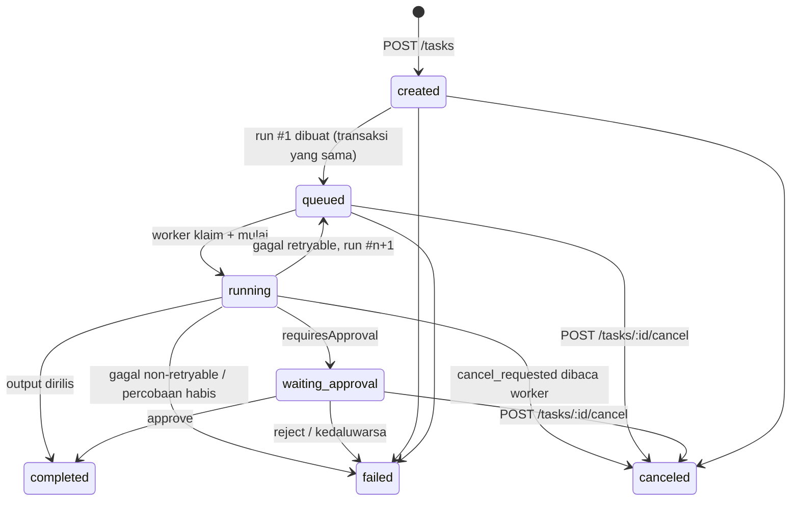
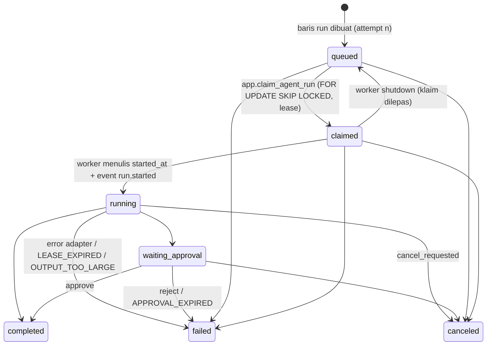

# Siklus Hidup Tugas & Run Agent

Phase 5 menambahkan domain **tugas** (perintah bisnis dari pengguna kepada AI employee), **run** (satu percobaan
eksekusi oleh worker), **event run** (jejak audit), **output** (hasil), dan **persetujuan**. Aturan murni ada di
`domains/tasks/types.ts` (dipakai backend dan frontend); skema database di `db/migrations/0008_agent_tasks.sql`;
service/repository di `api/modules/{tasks,runs,approvals}/`.

**Status:** VERIFIED COMPLETE dengan runtime fixture (test integrasi `tests/integration/tasks.test.ts`,
`tests/integration/worker.test.ts`; isolasi `tests/security/task-isolation.test.ts`). Penyedia AI nyata: BLOCKED
(lihat `docs/agent-runtime-adapters.md`).

## 1. Model data

Semua tabel ber-`tenant_id NOT NULL`, `ENABLE` + `FORCE ROW LEVEL SECURITY`, terdaftar di `RLS_PROTECTED_TABLES`.
Relasi ke agent/tugas/run memakai **kunci asing komposit** `(id, tenant_id)` sehingga baris anak tidak mungkin
menunjuk induk tenant lain, bahkan bila kebijakan RLS keliru.

| Tabel               | Kolom kunci                                                                                                                                                                                                                                                                                      | Catatan                                                                              |
| ------------------- | ------------------------------------------------------------------------------------------------------------------------------------------------------------------------------------------------------------------------------------------------------------------------------------------------ | ------------------------------------------------------------------------------------ |
| `agent_tasks`       | `agent_id`, `created_by_user_id`, `title`, `instruction` (≤ 8000), `priority`, `status`, `requires_approval`, `idempotency_key`, `latest_run_id`, `attempts`, `max_attempts`, `error_code`, `error_message`, `queued_at`, `started_at`, `completed_at`                                           | Unik `(tenant_id, created_by_user_id, idempotency_key)`                              |
| `agent_runs`        | `task_id`, `agent_id`, `attempt`, `status`, `runtime_provider`, `runtime_model`, `worker_id`, `lease_expires_at`, `claimed_at`, `started_at`, `completed_at`, `cancel_requested`, `error_code`, `error_message`, `retryable`, `provider_request_id`, `usage_input_tokens`, `usage_output_tokens` | Unik `(task_id, attempt)`; usage hanya dari penyedia                                 |
| `agent_run_events`  | `run_id`, `task_id`, `event_type`, `payload` jsonb (≤ 16 KB)                                                                                                                                                                                                                                     | Append-only (tanpa GRANT UPDATE/DELETE untuk role runtime); jejak audit teknis       |
| `agent_run_outputs` | `run_id`, `task_id`, `output_type` (`text`/`markdown`), `content` (≤ 200k), `released`                                                                                                                                                                                                           | Unik `run_id` (satu hasil per run); `released=false` sampai persetujuan              |
| `agent_approvals`   | `task_id`, `run_id`, `agent_id`, `action_type`, `action_summary`, `status`, `requested_by`, `requested_at`, `expires_at`, `decided_by_user_id`, `decided_at`, `decision_note`                                                                                                                    | Unik `(run_id, action_type)`; lihat `docs/agent-approval-workflow.md`                |
| `realtime_outbox`   | `event_type`, `schema_version`, `agent_id`, `task_id`, `run_id`, `payload`                                                                                                                                                                                                                       | Ditulis dalam transaksi yang sama dengan perubahan; dibaca hub SSE; dipangkas worker |

`version` pada tugas/run/persetujuan bertambah setiap pembaruan (`updated_at` ikut); transisi memakai CAS pada
`status` sehingga penulis yang kalah perlombaan mengenai 0 baris, bukan menimpa.

## 2. Siklus hidup tugas

`TASK_TRANSITIONS` (sumber kebenaran, dipakai `canTransitionTask`):

| Dari               | Ke                                                              |
| ------------------ | --------------------------------------------------------------- |
| `created`          | `queued`, `canceled`, `failed`                                  |
| `queued`           | `running`, `canceled`, `failed`                                 |
| `running`          | `completed`, `failed`, `waiting_approval`, `canceled`, `queued` |
| `waiting_approval` | `completed`, `failed`, `canceled`                               |
| terminal           | — (`completed`, `failed`, `canceled` tidak dapat diubah)        |

## 3. Siklus hidup run

Satu tugas dapat memiliki beberapa run (`attempt` 1..`max_attempts`); `agent_tasks.latest_run_id` dan `attempts`
menunjuk run terbaru. Status runtime agent (`GET /agents` → `runtimeStatus`) diturunkan dari run aktif:
`queued`/`claimed` → `thinking`, `running` → `working`, `waiting_approval` → `waiting_approval`, tidak ada → `null`.

## 4. Pembuatan tugas (`POST /api/v1/tasks`)

Urutan pemeriksaan di `tasksService.create` (semua sebelum menulis):

| Langkah                                                                   | Gagal → HTTP / `code`                              |
| ------------------------------------------------------------------------- | -------------------------------------------------- |
| Pembatas laju per pengguna (`RATE_LIMIT_TASK_CREATE_*`, `consume` atomik) | 429 `TOO_MANY_REQUESTS` (+ `Retry-After`)          |
| Runtime tersedia                                                          | 409 `RUNTIME_NOT_CONFIGURED`                       |
| Instruksi tidak kosong, ≤ `AI_MAX_INSTRUCTION_CHARS`                      | 422 `INSTRUCTION_EMPTY` / `INSTRUCTION_TOO_LONG`   |
| Agent milik tenant & `active`                                             | 404 `AGENT_NOT_FOUND` / 409 `AGENT_NOT_ASSIGNABLE` |
| Idempotensi: kunci sudah ada untuk pengguna ini                           | 200 `{ created: false, task }` (tugas yang sama)   |
| Tugas aktif tenant < `AI_TENANT_MAX_ACTIVE_RUNS`                          | 429 `TOO_MANY_REQUESTS` (detail `maxActiveTasks`)  |
| Tugas hari ini < `AI_TENANT_DAILY_RUN_LIMIT`                              | 429 `TOO_MANY_REQUESTS` (detail `dailyTaskLimit`)  |

Bila lolos, dalam **satu transaksi tenant**: tugas `created` → run #1 `queued` → tugas `queued` → event
`agent.task.created` + `agent.task.queued` ke outbox → 201 `{ created: true, task }`. `title` default = instruksi
dipotong 200 karakter.

### Idempotensi

`idempotencyKey` (`^[A-Za-z0-9._:-]{8,128}$`) unik per `(tenant, pengguna)`. Pengiriman ulang (klik ganda, retry
jaringan) mengembalikan tugas yang sama dengan `created: false`; perlombaan dua insert identik ditangani
`on conflict` + pembacaan ulang. Panel perintah membuat kunci acak per teks+opsi dan memakainya ulang hanya saat
mencoba ulang pengiriman yang gagal.

## 5. Konkurensi dan keutuhan

- **Klaim antrean**: `app.claim_agent_run(worker_id, lease_seconds)` (SECURITY DEFINER, lintas tenant karena antrean
  bersama) memilih satu run `queued` dengan `FOR UPDATE SKIP LOCKED`, menandai `claimed`, `worker_id`,
  `lease_expires_at`. Banyak worker aman; satu run tidak pernah diklaim dua kali.
- **Transisi CAS**: repository mengubah status dengan `where status = any(from) [and worker_id = $worker]`; hasil 0
  baris berarti state sudah berubah (dibatalkan, lease dipulihkan worker lain) dan pemanggil tidak menimpa.
- **Terminal dilindungi**: tidak ada transisi keluar dari `completed`/`failed`/`canceled` (diuji: pembatalan tugas
  selesai → 409 `TASK_ALREADY_FINISHED`; penulisan worker setelah terminal → 0 baris).
- **Satu output per run** (`unique run_id`, `on conflict do nothing`); percobaan ulang membuat run baru, bukan menimpa
  output run lama.
- **Lease**: run yang `lease_expires_at` lewat dipulihkan worker mana pun (`app.expired_run_leases`) → `failed`
  `LEASE_EXPIRED` (retryable) → run baru bila kuota ada. Semantik **at-least-once**: eksekusi yang terputus dapat
  diulang; hasil run yang lease-nya hilang tidak ditulis.
- **Pembatalan**: `queued`/`waiting_approval` → `canceled` langsung; `running` → `cancel_requested = true`, worker
  membacanya saat heartbeat dan membatalkan adapter (`CANCELED`, tidak diulang).

## 6. Endpoint

| Method & path                               | Izin           | Keterangan                                                                                             |
| ------------------------------------------- | -------------- | ------------------------------------------------------------------------------------------------------ |
| `GET /api/v1/tasks/capabilities`            | `tasks.read`   | Runtime (`available`, `kind`, `provider`, `model`), `canCreate`, `canCancel`, batas & pemakaian        |
| `POST /api/v1/tasks`                        | `tasks.create` | Body `agentId`, `instruction`, `title?`, `priority?`, `requiresApproval?`, `idempotencyKey?` → 201/200 |
| `GET /api/v1/tasks?agentId=&status=&limit=` | `tasks.read`   | Daftar tugas tenant aktif (terbaru dahulu)                                                             |
| `GET /api/v1/tasks/:id`                     | `tasks.read`   | Detail + `runs[]` + ketersediaan `output` (tanpa isi)                                                  |
| `POST /api/v1/tasks/:id/cancel`             | `tasks.cancel` | 409 `TASK_ALREADY_FINISHED` bila terminal                                                              |
| `GET /api/v1/tasks/:id/runs`                | `tasks.read`   | Semua percobaan                                                                                        |
| `GET /api/v1/runs/:id`                      | `tasks.read`   | Detail run (status, kode error aman, `usage` bila ada)                                                 |
| `GET /api/v1/runs/:id/events`               | `tasks.read`   | Jejak event run (payload aman, tanpa prompt/keluaran model)                                            |
| `GET /api/v1/runs/:id/output`               | `tasks.read`   | Isi hasil; 404 `OUTPUT_NOT_FOUND`; 409 `OUTPUT_PENDING_APPROVAL`                                       |

Semua respons bertipe penuh lewat Eden (`app/utils/api-types.ts`: `TaskItem`, `TaskDetail`, `TaskRun`,
`TaskCapabilities`, `ApprovalItem`, `RunOutput`). Kode error run yang aman ditampilkan: `RUN_ERROR_CODES`
(`RUNTIME_NOT_CONFIGURED`, `PROVIDER_TIMEOUT`, `PROVIDER_UNAVAILABLE`, `PROVIDER_REJECTED`, `PROVIDER_RATE_LIMITED`,
`PROVIDER_INVALID_RESPONSE`, `OUTPUT_TOO_LARGE`, `LEASE_EXPIRED`, `CANCELED`, `APPROVAL_REJECTED`,
`APPROVAL_EXPIRED`, `ATTEMPTS_EXHAUSTED`, `INTERNAL_ERROR`) dengan pesan Bahasa Indonesia di `RUN_ERROR_MESSAGES`.

## 7. RLS dan izin (migrasi 0008)

Izin baru: `tasks.read`, `tasks.create`, `tasks.cancel`, `approvals.read`, `approvals.decide`. Pemetaan peran sistem:

| Peran  | tasks.read | tasks.create | tasks.cancel | approvals.read | approvals.decide |
| ------ | :--------: | :----------: | :----------: | :------------: | :--------------: |
| owner  |     ✓      |      ✓       |      ✓       |       ✓        |        ✓         |
| admin  |     ✓      |      ✓       |      ✓       |       ✓        |        ✓         |
| member |     ✓      |      ✓       |      ✓       |       ✓        |        —         |
| viewer |     ✓      |      —       |      —       |       ✓        |        —         |

Dua helper baru:

- `app.is_worker()` — benar hanya bila `app.actor = 'worker'` di transaksi saat ini; **hanya** `withWorkerTransaction`
  (`api/core/database/transactions.ts`) yang menyetelnya, dan hanya worker yang memakainya.
- `app.is_privileged_caller()` — benar untuk pemilik skema (bukan anggota `agentic_runtime`); dipakai agar fungsi
  SECURITY DEFINER sempit dapat melihat antrean lintas tenant walau `FORCE RLS` berlaku pada pemilik.

Kebijakan (ringkas): SELECT = tenant aktif (atau pemilik untuk fungsi definer); INSERT tugas = tenant aktif **dan**
`app.has_permission('tasks.create')` **dan** `created_by_user_id = app.current_user_id()` (atau worker); UPDATE
tugas = worker, atau `tasks.cancel`; run/event/output = INSERT/UPDATE hanya worker (kecuali `cancel_requested`
lewat `tasks.cancel` dan perilisan output lewat `approvals.decide`); persetujuan = INSERT worker, UPDATE worker atau
`approvals.decide`. Role runtime **tidak** memiliki `DELETE` pada tabel bisnis; outbox dipangkas lewat fungsi definer.
Hasilnya, kehilangan izin di database membuat `UPDATE` dari API mana pun mengenai 0 baris — bukan hanya 403 di
service.

Diuji di `tests/security/task-isolation.test.ts`: tenant B 0 baris untuk tugas/run/outbox A dan tidak dapat
mengubahnya; FK komposit menolak run/tugas lintas tenant; viewer tanpa `tasks.create` ditolak database; pengguna biasa
tidak dapat menulis output; worker tenant B tidak dapat menulis run A; `select` tanpa konteks = 0 baris sementara
fungsi klaim melihat antrean; role runtime tidak dapat mematikan RLS/menghapus kebijakan/menghapus outbox; 12
transaksi paralel dua tenant tetap terisolasi.
